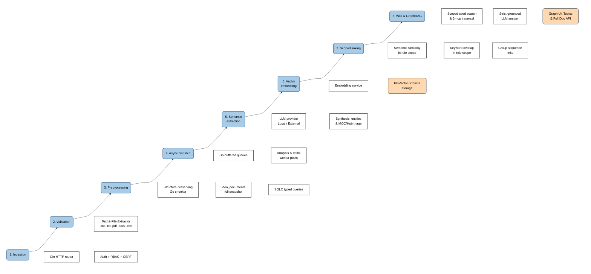

# Thinker

#### Idioma / Language

- [Español](#español)
- [English](#english)

---

#### Índice de contenidos / Table of Contents

**Español**
- [Inicio rápido para usuarios](#inicio-rápido-para-usuarios)
  - [Acceso a producción y Cuenta DEMO](#acceso-a-producción-y-cuenta-demo)
  - [Guía de usuario](#guía-de-usuario)
  - [Buenas prácticas: cómo documentar y preguntar con precisión y seguridad](#buenas-prácticas-cómo-documentar-y-preguntar-con-precisión-y-seguridad)
- [Detalles técnicos](#detalles-técnicos)
  - [Descripción general y stack](#descripción-general-y-stack)
  - [Arquitectura y flujo de datos](#arquitectura-y-flujo-de-datos)
  - [Estructura del proyecto](#estructura-del-proyecto)
  - [Seguridad y control de acceso (RBAC)](#seguridad-y-control-de-acceso-rbac)
  - [Configuración, ejecución y pruebas](#configuración-ejecución-y-pruebas)
  - [Estado actual y referencias](#estado-actual-y-referencias)

**English**
- [Quick Start for Regular Users](#quick-start-for-regular-users)
  - [Production Access and DEMO Account](#production-access-and-demo-account)
  - [User Guide](#user-guide)
  - [Best Practices: Documenting and Querying with Precision and Security](#best-practices-documenting-and-querying-with-precision-and-security)
- [Technical Details](#technical-details)
  - [Overview and Stack](#overview-and-stack)
  - [Architecture and Data Flow](#architecture-and-data-flow)
  - [Project Structure](#project-structure)
  - [Security and Access Control (RBAC)](#security-and-access-control-rbac)
  - [Configuration, Execution and Testing](#configuration-execution-and-testing)
  - [Current Status and References](#current-status-and-references)

---

# Español

#### Inicio rápido para usuarios

Puedes acceder a la plataforma en producción en: https://thinker.angel-velasco.com

#### Acceso a producción y Cuenta DEMO

**Cuenta DEMO**

Puedes probar las funcionalidades de thinker al ingresar con una cuenta demo, para ello
es necesario ingresar con un usuario y contraseña preestablecidos.
> * Usuario: thinker.demo@gmail.com
> * Contraseña: thinker1234

Este usuario cuenta con rol demo, por lo que solo es posible ver en primera instancia guías de usuario y soporte genera, además de descripciones de productos relacionados con la plataforma.

Si quieres generar y ver tus propias ideas, no existe restricción para dicho rol y usuario.

#### Guía de usuario

**Qué es Thinker**

Thinker es un espacio de conocimiento colaborativo que transforma notas y documentos en una red de ideas conectadas, respetando el alcance de acceso de cada persona y equipo. En lugar de ordenar archivos en carpetas manuales, la plataforma analiza cada texto, extrae conceptos clave y enlaza únicamente la información que pertenece al mismo ámbito de acceso.

**Flujo de uso**

Acceso: usuario / google

↓

Mis ideas: crear / subir archivo

↓

Síntesis, extracción de términos clave y tópicos

↓

→ Red: explorar grafo y relaciones creadas

→ Pregunta a thinker: consultar red y conexiones

→ Temas e índices: Temas principales y subtemas

**Cómo iniciar sesión**

• Abre Thinker y selecciona Iniciar sesión, o Crear cuenta si aún no tienes usuario.

• Si te registras con correo y contraseña, abre el enlace de confirmación que llega a tu correo en los siguientes quince minutos.

• Si prefieres acceso directo, selecciona Continuar con Google.

Al entrar verás la barra superior con acceso a Red, Mis ideas y Temas e índices. Si tu cuenta tiene privilegios de Superusuario, verás además la etiqueta Super junto a tu nombre y el acceso a Usuarios y roles.

> Si acabas de registrarte por primera vez y no ves notas compartidas de otros equipos, es el comportamiento esperado: un superusuario debe asignarte tus roles correspondientes.

**Cómo crear notas y subir documentos**

• Entra a Mis ideas y pulsa Nueva idea.

• Escribe un título y redacta el contenido en el editor Markdown, donde puedes cambiar entre escribir, dividir pantalla o ver vista previa.

• Para subir un archivo, pulsa Adjuntar archivo y elige un documento `.md`, `.txt`, `.pdf`, `.docx` o `.csv`.

• Si subes texto plano o Markdown puedes usar Cargar en el editor antes de guardarlo, y si dejas el título vacío se usará el nombre del archivo.

• (Opcional) Abre la sección Visibilidad y permisos por rol debajo del editor para elegir qué roles tendrán permiso de Solo ver o Ver y editar. Si no seleccionas ninguno, la nota se guardará como Privada.

• Pulsa Guardar idea para enviar el contenido al análisis automático. Al guardarse, los textos largos se dividen en fragmentos y pasan brevemente por el estado Borrador antes de quedar en Procesada.

En el listado de Mis ideas cada tarjeta muestra sus etiquetas de visibilidad (Privada o los roles con Ver / Editar). Al abrir cualquier idea accesible puedes revisar su síntesis, el texto original, autor, quién realizó la última edición, términos extraídos y conexiones visibles; según tus permisos podrás editarla, volverla a analizar, eliminarla o reconfigurar sus roles.

**Cómo funcionan los roles (qué es por defecto y qué debe ser explícito)**

Thinker trabaja con dos niveles globales (Superusuario y Usuario estándar) combinados con roles dinámicos creados por la administración (por ejemplo: Ingeniería, Ventas, Dirección).

_Lo que ocurre por defecto (sin configurar nada extra)_

• Nuevos usuarios: Toda cuenta nueva (registro por correo o Google) se crea como usuario estándar y sin roles asignados.

• Nuevas notas: Toda idea nueva nace Privada. Solo su autor y los superusuarios pueden verla, editarla, eliminarla o compartirla.

• Notas heredadas/sin roles: Si una nota no tiene permisos de rol registrados, permanece privada para su autor y superusuarios.

• Documentos fragmentados: Al crear una nota larga dividida en fragmentos o actualizar sus permisos en el detalle, los permisos de rol se replican automáticamente a todos los fragmentos del mismo documento.

• Temas e índices: Los usuarios estándar ven únicamente los temas principales y subtemas donde exista al menos una nota accesible para ellos. No ven categorías vacías ni categorías pertenecientes solo a otros roles.

• Aislamiento de enlaces: Thinker nunca conecta automáticamente una nota privada tuya con notas de otras personas si no comparten un rol.

_Lo que debes configurar de forma explícita_

• Creación de roles: Los roles no existen predefinidos; un superusuario debe crearlos en Usuarios y roles → Roles (nombre y descripción opcional; el identificador slug se genera automáticamente).

• Asignación de roles a usuarios: Un superusuario debe asignar explícitamente uno o más roles a cada usuario (al crearlo en Nuevo usuario o mediante Gestionar acceso en Usuarios asociados).

• Compartir una nota con un rol: El autor de la nota o un superusuario debe elegir explícitamente en cada rol entre:
> * Sin acceso (valor por defecto).
> * Solo ver: Permite leer la nota, verla en Red, consultarla en Pregunta a Thinker y verla en Temas e índices.
> * Ver y editar: Todo lo anterior, más permiso para Editar idea y Volver a analizar (registrando al editor como último modificador).
> * Privilegios de superusuario: Conceder o retirar el rol de superusuario se hace explícitamente en Usuarios y roles.

_Matriz rápida de capacidades_

| Acción | Autor de la nota | Rol con `Solo ver` | Rol con `Ver y editar` | Superusuario |
| --- | :---: | :---: | :---: | :---: |
| Ver nota, grafo y usar en Pregunta a thinker | Sí | Sí | Sí | Sí (todas) |
| Editar contenido y reanalizar | Sí | No | Sí | Sí |
| Eliminar nota o fragmento | Sí | No | No | Sí |
| Cambiar permisos por rol | Sí | No | No | Sí |
| Administrar temas y subtemas | No | No | No | Sí |
| Gestionar usuarios y roles | No | No | No | Sí |

**Cómo explorar la red de ideas y conexiones**

• Entra a Red desde el menú superior para ver el mapa visual de tu conocimiento.

• Identifica los elementos por color:
> * Morado: temas maestros
> * Cian: conceptos agrupadores
> * Azul: ideas
> * Ámbar: palabras clave
> * Líneas cian: afinidad semántica
> * Líneas verdes: conceptos en común

• Haz clic en cualquier nodo para centrar la vista, resaltar sus vecinos y abrir el panel Detalle de selección con su contenido y enlaces directos.

• Usa Ocultar temas para ver solo las ideas o Centrar red para reencuadrar el mapa.

**Cómo hacer preguntas**

• Dentro de Red, abre el panel Pregunta a Thinker.

• Escribe tu consulta en el cuadro inferior y presiona Enter o pulsa Preguntar.

• Lee la respuesta generada exclusivamente a partir de las notas y conexiones a las que tienes permiso de lectura.

• Haz clic en cualquiera de las Fuentes y conexiones consultadas que aparecen debajo para ubicar e inspeccionar esa nota en el grafo.

**Cómo organizar temas**

• Entra a Temas e índices para consultar tus notas agrupadas en temas principales y subtemas.

• Si eres usuario estándar: Verás en modo lectura los temas y subtemas derivados de tus notas propias y compartidas.

• Si eres superusuario: Tendrás habilitados los controles de administración:
> * Activar o pausar Organización automática según prefieras que Thinker cree categorías nuevas por su cuenta o respete solo las actuales.
> * Crear categorías manuales con Nuevo tema principal o Subtema, fijar un tema (Fijar / Liberar) para evitar cambios automáticos, eliminar categorías o usar Mover para reubicar una nota en otro subtema.

**Cómo administrar usuarios y roles (solo superusuarios)**

• Entra a Usuarios y roles desde la barra superior.

• En Roles puedes crear nuevos roles (por ejemplo Producto, Legal, Soporte), editar su nombre/descripción o eliminarlos. Al ver la tabla verás cuántos usuarios y cuántas notas usan cada rol; si eliminas un rol, Thinker lo retira de usuarios y notas y recalcula las conexiones afectadas en el grafo.

• En Usuarios asociados puedes ver el nivel (Superusuario o Estándar) y los roles de cada cuenta, y pulsar Gestionar acceso para modificar sus roles o privilegios.

• En Nuevo usuario puedes dar de alta cuentas locales verificadas asignando desde el inicio sus roles y si será superusuario.

**Cómo se maneja la seguridad en Thinker**

_Autenticación y vigencia de sesiones_

Al iniciar sesión se emiten un token de acceso firmado, encriptado y con vigencia de 15 minutos y uno adicional que garantiza rotación y almacenamiento seguro.

El menú superior incorpora Salir (cierra la sesión actual) y el botón de encendido para cerrar todas las sesiones activas, que revoca todos los tokens de acceso.

_Evaluación de permisos en tiempo real y doble barrera_

En cada petición protegida, siempre se valida la versión de token y recarga los roles actuales del usuario y su estado de superusuario. No se confía en los roles que se guardan en los tokens de acceso. Las rutas administrativas están protegidas tanto por middleware como por validación directa en cada servicio.

Cuando un usuario no tiene acceso a una idea, el servidor responde con No encontrada (404) en lugar de revelar que la nota existe.

_Protección contra degradación accidental o bloqueo administrativo_

Un superusuario no puede quitarse a sí mismo el privilegio de superusuario.

El sistema impide retirar el privilegio al último superusuario activo para evitar dejar la plataforma sin administración.

Cuando a un superusuario se le retira ese privilegio, el sistema revoca todos sus tokens, cerrando sus sesiones activas al instante.

#### Buenas prácticas: cómo documentar y preguntar con precisión y seguridad

Thinker es un asistente agnóstico al dominio, responde exclusivamente a partir de la documentación indexada a la que tu usuario tiene acceso. Si un dato no está respaldado en tus notas o no tienes permiso para verlo, no lo inventará ni lo completará con suposiciones externas.
> Thinker utiliza modelos de lenguaje y búsquedas semánticas, por lo que puede cometer errores.

**Cómo redactar notas y subir documentos**

_Usa títulos claros y contexto completo_

Nombra explícitamente el tema, área, producto o regla desde el título y los primeros párrafos. Evita frases ambiguas ("como vimos ayer", "aplica igual que el otro"), ya que los documentos largos se dividen en fragmentos independientes durante el análisis.

_Estructura en Markdown_

Organiza el contenido con encabezados (#, ##), listas y reglas explícitas. Así la síntesis, los conceptos clave y las relaciones del grafo serán mucho más precisos.

_Elige el formato adecuado_

Puedes subir .md, .txt, .pdf, .docx o .csv. Si subes .md o .txt, usa Cargar en el editor para revisar o limpiar encabezados innecesarios antes de guardar. En PDF, asegúrate de que contenga texto seleccionable (no solo imagen escaneada).

_Define la visibilidad desde el inicio_

Toda nota se guarda como Privada por defecto (solo tú y superusuarios). Si contiene información operativa para un equipo, selecciona explícitamente qué roles tienen Solo ver o Ver y editar en Visibilidad y permisos por rol.

_Protege datos sensibles_

No guardes contraseñas, llaves privadas ni tokens dentro de notas compartidas por rol; mantén la información restringida únicamente en los roles que realmente la necesitan (Thinker no conecta ni mezcla contexto entre roles distintos).

_Verifica el procesamiento_

Espera unos segundos a que la nota pase de Borrador a Procesada y revisa en su detalle que la síntesis y las palabras clave reflejen lo importante.

---

#### Detalles técnicos

#### Descripción general y stack

Thinker es un grafo de conocimiento asociativo y wiki colaborativa asistida por LLM, inspirada en el patrón LLM Wiki. En lugar de depender de jerarquías manuales de carpetas o recuperación RAG plana, cada nota o documento se ingiere, fragmenta respetando su estructura Markdown, se sintetiza y clasifica automáticamente en temas jerárquicos, y se enlaza dentro del alcance de permisos correspondiente.

**Stack tecnológico**

_Backend y base de datos_
- Go 1.26.5
- Gin (`github.com/gin-gonic/gin v1.12.0`) y `github.com/gin-contrib/multitemplate v1.1.4`
- PostgreSQL 16 con `pgvector` vía `github.com/jackc/pgx/v5 v5.11.0` y consultas tipadas generadas con `sqlc`
- SQLite puro en Go (`modernc.org/sqlite v1.61.1`) para ejecución rápida de pruebas unitarias e integración HTTP sin dependencias externas
- Configuración con `github.com/joho/godotenv v1.5.1`

_Modelos de lenguaje y embeddings_
- Modo local mediante `llama-server`: `Qwen2.5-3B-Instruct-GGUF` (puerto 8081) y `bge-small-en-v1.5` (puerto 8082)
- Modo externo compatible con API OpenAI (configurable de forma independiente para LLM y embeddings)

_Frontend_
- Plantillas HTML renderizadas en servidor + HTMX (`2.0.4`) + Tailwind CSS v4
- Grafo interactivo con `force-graph`
- Renderizado Markdown en navegador con `marked` y sanitización XSS con `DOMPurify`

#### Arquitectura y flujo de datos



**Descripción de capas**

1. **Ingestión y autorización:** Router Gin con `SecurityHeadersMiddleware`, `CSRFMiddleware`, `AuthRateLimiter`, `RequireAuthMiddleware` (carga de roles en vivo desde BD) y `RequireSuperuserMiddleware` para rutas administrativas.
2. **Validación y extracción documental:** `chunker_service.go` extrae texto limpio de `.txt`, `.md`, `.csv`, `.docx` y `.pdf` (vía `pdftotext`, Quartz en macOS o extractor puro en Go con soporte CMap).
3. **Preprocesamiento y almacenamiento íntegro:** El fragmentador divide textos largos (~1,200 caracteres con solapamiento del 12 %) conservando saltos de párrafo (`\n\n`), listas, citas y bloques de código cercados. Cuando hay múltiples fragmentos, el documento íntegro se guarda en `idea_documents` por `group_id` para consulta bajo demanda (`GET /api/ideas/:id/full`), con reconstrucción sin solapamiento (`StitchChunksWithoutOverlap`) si se edita o elimina algún fragmento.
4. **Despacho asíncrono:** Colas acotadas en Go procesan en segundo plano el análisis semántico (`EnqueueIdeaAnalysis`) y el re-enlazado al cambiar permisos o eliminar roles (`EnqueueIdeaRelink`).
5. **Extracción semántica y taxonomía jerárquica:** Prompts externos en `prompts/` (`analyze_idea.md`, `triage_moc.md`, `expand_query.md`, `ask_knowledge_graph.md`) generan síntesis, conceptos clave, MOCs (temas maestros) y Hubs (subtemas).
6. **Embeddings y enlazado acotado al alcance:** Se crean enlaces `sequence` entre fragmentos del mismo documento, `concept_overlap` por términos en común y `semantic` por similitud coseno, restringidos estrictamente a ideas del mismo autor o que compartan al menos un rol.
7. **Consulta GraphRAG y visualización:** `FindSeedIdeas`, `FindHierarchicalSeeds` y `TraverseSubGraph` filtran cada nodo y salto contra el conjunto accesible del actor (`ListAccessibleIdeaIDSet`), alimentando la vista dividida 50/50 de Red y Chat en escritorio (`network.html`) y las vistas de detalle y temas.

#### Estructura del proyecto

```
thinker/
├── docs/
│   ├── dev/
│   └── user/
│       └── quickstart.md
├── internal/
│   ├── auth/          # JWT HS256, hashing de contraseñas, tokens opacos, normalización
│   ├── config/        # Carga de .env, validación JWT_SECRET y multitemplate renderer
│   ├── database/      # schema.sql, query.sql, código generado sqlc, conector y migraciones (001..006)
│   ├── dtos/
│   ├── handlers/      # auth_handler, idea_handler, role_handler, topic_handler, user_handler
│   ├── middleware/    # auth_middleware, cookies, csrf, rate_limiter
│   ├── routes/        # Registro de rutas públicas, protegidas y superuserOnly
│   ├── services/      # access_policy, auth, chunker, embedding, idea, keyword, llm, mailer, oauth, role, topic, user
│   └── urls/          # Diccionario centralizado de rutas nombradas
├── media/
├── models/
├── prompts/           # Plantillas de prompts del sistema LLM
├── static/
├── templates/
│   ├── includes/      # header, footer, _support_content, navs y gráficos landing
│   ├── layouts/       # base.html (con marked + DOMPurify)
│   ├── pages/         # auth, landing, support público
│   ├── partials/      # fragmentos HTMX para ideas, usuarios y roles
│   └── views/         # vistas completas (ideas, network, support, topics, users)
├── Makefile
├── docker-compose.yaml
├── main.go
└── sqlc.yaml
```

#### Seguridad y control de acceso (RBAC)

**Autenticación y cookies**
- Access Token JWT `HS256` con TTL de 15 minutos y Refresh Token opaco con rotación y revocación en base de datos (`refresh_tokens`, `action_tokens`).
- Cookies `HttpOnly` con `SameSite=Lax`; cuando `DEBUG=false` o `APP_BASE_URL` inicia con `https://`, se activan el flag `Secure` y el prefijo `__Host-`.
- En producción (`DEBUG=false`), `JWT_SECRET` es obligatorio con mínimo 32 bytes (256 bits) de entropía.

**Control de acceso basado en roles (RBAC)**
- Tablas `roles`, `user_roles` e `idea_role_permissions` (`view` | `edit`), más `users.is_superuser` e `ideas.updated_by`.
- En cada petición protegida, `RequireAuthMiddleware` valida `token_version` y recarga los roles vigentes desde la base de datos.
- Al degradar a un superusuario se incrementa su `token_version` y se revocan todos sus refresh tokens; no se permite auto-degradarse ni retirar al último superusuario activo.
- Las rutas administrativas (`/web/users/*`, `/api/users`, `/web/roles/*` y mutaciones de `/web/topics/*`) exigen `RequireSuperuserMiddleware` y revalidación en capa de servicio.

**Protección web**
- `CSRFMiddleware` con comparación en tiempo constante (`X-CSRF-Token` o campo `csrf_token`).
- `AuthRateLimiter`: 15 peticiones/minuto por IP y 5 peticiones cada 15 minutos por correo en endpoints sensibles de autenticación.
- `SecurityHeadersMiddleware`: `X-Content-Type-Options: nosniff`, `X-Frame-Options: DENY`, `Referrer-Policy`, `Permissions-Policy`, `Content-Security-Policy` y bloqueo de `TRACE`.
- Sanitización de Markdown renderizado con `DOMPurify` en cliente.

#### Configuración, ejecución y pruebas

**Variables de entorno principales (`.env`)**

_Aplicación y seguridad_
- `DEBUG` (`true` / `false`)
- `APP_BASE_URL` (ej. `https://thinker.angel-velasco.com` en producción)
- `JWT_SECRET` (obligatorio en producción, mínimo 32 bytes en texto, hex o base64)
- `SUPERUSER_EMAIL` (correo promovido automáticamente a superusuario al iniciar o registrarse)

_Base de datos_
- `CONN_STRING` o `DB_HOST`, `DB_PORT`, `DB_NAME`, `DB_USERNAME`, `DB_PASSWORD`

_Proveedores de IA y prompts_
- `EXTERNAL_LLM_PROVIDER`, `LLM_API_KEY`, `LLM_BASE_URL`, `LLM_MODEL`
- `EXTERNAL_EMBEDDING_PROVIDER`, `EMBEDDING_API_KEY`, `EMBEDDING_BASE_URL`, `EMBEDDING_MODEL`
- `PROMPTS_DIR` (por defecto `prompts`)

_OAuth y correo_
- `GOOGLE_CLIENT_ID`, `GOOGLE_CLIENT_SECRET`, `GOOGLE_REDIRECT_URL`
- `SMTP_HOST`, `SMTP_PORT`, `SMTP_USER`, `SMTP_PASS`, `SMTP_FROM`

**Comandos útiles**

Levantar infraestructura con Docker (`pgvector` + embeddings):
```bash
make up
```

Ejecutar en local:
```bash
go run .
```

Regenerar consultas tipadas tras modificar `internal/database/query.sql` o `schema.sql`:
```bash
sqlc generate
```

Ejecutar toda la suite de pruebas (auth, config, database, middleware, routes, services, prompts):
```bash
go test ./...
```

Compilar binario estático de producción para Linux `amd64`:
```bash
CGO_ENABLED=0 GOOS=linux GOARCH=amd64 go build -ldflags="-s -w" -o thinker .
```

#### Estado actual y referencias

**Estado actual**
- Autenticación completa (correo/contraseña con verificación en 15m, recuperación de contraseña, Google OAuth, JWT + refresh tokens, CSRF y rate limiting).
- Ingestión síncrona/asíncrona de notas Markdown y documentos (`.txt`, `.md`, `.pdf`, `.docx`, `.csv`) con chunking que preserva formato y vista bajo demanda de documento completo (`GET /api/ideas/:id/full`).
- Extracción semántica con LLM, embeddings vectoriales, grafo interactivo (`force-graph`) con layout 50/50 junto al chat GraphRAG y organización jerárquica automática/manual en MOCs y Hubs.
- Control de acceso RBAC completo con roles dinámicos, visibilidad por nota, enlazado acotado al alcance, aislamiento en grafo/RAG/temas y vista pública/autenticada de Soporte.

**Referencias**
1. https://gist.github.com/karpathy/442a6bf555914893e9891c11519de94f

---

# English

#### Quick Start for Regular Users

You can access the live production platform at: https://thinker.angel-velasco.com

#### Production Access and DEMO Account

**DEMO Account**

You can try Thinker's features by signing in with a demo account using the preset credentials below:
> * User: thinker.demo@gmail.com
> * Password: thinker1234

This user has the demo role, so initially you can only view user guides, general support, and platform product descriptions.

If you want to create and view your own ideas, there is no restriction for that role and user.

#### User Guide

**What Thinker Is**

Thinker is a collaborative knowledge space that transforms notes and documents into a network of connected ideas while respecting each person's and team's access scope. Instead of organizing files into manual folders, the platform analyzes each text, extracts key concepts, and links only information belonging to the same access scope.

**Usage Flow**

Access: user / google

↓

My Ideas: create / upload file

↓

Synthesis, key term and topic extraction

↓

→ Network: explore graph and created relationships

→ Ask Thinker: query network and connections

→ Topics and Indexes: Main topics and subtopics

**How to Sign In**

• Open Thinker and select Sign In, or Create Account if you do not have a user yet.

• If you register with email and password, open the confirmation link sent to your email within the next fifteen minutes.

• If you prefer direct access, select Continue with Google.

Upon signing in you will see the top bar with access to Network, My Ideas, and Topics and Indexes. If your account has Superuser privileges, you will also see the Super badge next to your name and access to Users and Roles.

> If you just registered for the first time and do not see shared notes from other teams, this is the expected behavior: a superuser must assign your corresponding roles.

**How to Create Notes and Upload Documents**

• Go to My Ideas and click New Idea.

• Enter a title and write the content in the Markdown editor, where you can switch between write, split screen, or preview.

• To upload a file, click Attach File and choose a `.md`, `.txt`, `.pdf`, `.docx`, or `.csv` document.

• If you upload plain text or Markdown you can click Load into Editor before saving, and if you leave the title empty the file name will be used.

• (Optional) Open the Role Visibility and Permissions section below the editor to choose which roles will have View Only or View and Edit permission. If you select none, the note is saved as Private.

• Click Save Idea to send the content to automatic analysis. When saved, long texts are split into fragments and briefly pass through the Draft status before becoming Processed.

In the My Ideas list each card displays its visibility badges (Private or roles with View / Edit). When opening any accessible idea you can review its synthesis, original text, author, who made the last edit, extracted terms, and visible connections; depending on your permissions you can edit, reanalyze, delete, or reconfigure its roles.

**How Roles Work (Default vs. Explicit Behavior)**

Thinker operates with two global levels (Superuser and Standard User) combined with dynamic roles created by administration (for example: Engineering, Sales, Leadership).

_What happens by default (without extra configuration)_

• New users: Every new account (email or Google sign-up) is created as a standard user with no assigned roles.

• New notes: Every new idea is created as Private. Only its author and superusers can view, edit, delete, or share it.

• Legacy/unassigned notes: If a note has no registered role permissions, it remains private to its author and superusers.

• Fragmented documents: When creating a long note split into fragments or updating its permissions in the detail view, role permissions are automatically replicated across all fragments of the same document.

• Topics and Indexes: Standard users see only the main topics and subtopics containing at least one accessible note. They do not see empty categories or categories belonging exclusively to other roles.

• Link isolation: Thinker never automatically connects a private note of yours with notes from other people unless they share a role.

_What must be configured explicitly_

• Role creation: Roles are not predefined; a superuser must create them in Users and Roles → Roles (name and optional description; the slug identifier is generated automatically).

• Assigning roles to users: A superuser must explicitly assign one or more roles to each user (when creating them in New User or via Manage Access in Associated Users).

• Sharing a note with a role: The note author or a superuser must explicitly choose for each role between:
> * No access (default value).
> * View only: Allows reading the note, seeing it in Network, querying it in Ask Thinker, and seeing it in Topics and Indexes.
> * View and edit: All of the above, plus permission to Edit Idea and Reanalyze (recording the editor as last modifier).
> * Superuser privileges: Granting or revoking the superuser role is done explicitly in Users and Roles.

_Quick Capability Matrix_

| Action | Note Author | Role with `View only` | Role with `View and edit` | Superuser |
| --- | :---: | :---: | :---: | :---: |
| View note, graph, and use in Ask Thinker | Yes | Yes | Yes | Yes (all) |
| Edit content and reanalyze | Yes | No | Yes | Yes |
| Delete note or fragment | Yes | No | No | Yes |
| Change role permissions | Yes | No | No | Yes |
| Manage topics and subtopics | No | No | No | Yes |
| Manage users and roles | No | No | No | Yes |

**How to Explore the Network of Ideas and Connections**

• Go to Network from the top menu to view the visual map of your knowledge.

• Identify elements by color:
> * Purple: master topics
> * Cyan: grouping concepts
> * Blue: ideas
> * Amber: keywords
> * Cyan lines: semantic affinity
> * Green lines: shared concepts

• Click any node to center the view, highlight its neighbors, and open the Selection Detail panel with its content and direct links.

• Use Hide Topics to view only ideas or Center Network to reframe the map.

**How to Ask Questions**

• Inside Network, open the Ask Thinker panel.

• Type your query in the bottom box and press Enter or click Ask.

• Read the answer generated exclusively from notes and connections you have permission to read.

• Click any of the Sources and Connections Consulted shown below to locate and inspect that note in the graph.

**How to Organize Topics**

• Go to Topics and Indexes to browse your notes grouped into main topics and subtopics.

• If you are a standard user: You will see in read-only mode the topics and subtopics derived from your own and shared notes.

• If you are a superuser: Administration controls are enabled:
> * Enable or pause Automatic Organization depending on whether you want Thinker to create new categories on its own or stick to existing ones.
> * Create manual categories with New Main Topic or Subtopic, lock a topic (Lock / Release) to prevent automatic changes, delete categories, or use Move to relocate a note into another subtopic.

**How to Manage Users and Roles (Superusers Only)**

• Go to Users and Roles from the top bar.

• In Roles you can create new roles (e.g., Product, Legal, Support), edit their name/description, or delete them. The table shows how many users and notes use each role; if you delete a role, Thinker removes it from users and notes and recalculates affected graph connections.

• In Associated Users you can see each account's level (Superuser or Standard) and roles, and click Manage Access to update its roles or privileges.

• In New User you can register verified local accounts while assigning their initial roles and superuser status.

**How Security Is Handled in Thinker**

_Authentication and session lifetime_

Upon signing in, a signed, encrypted access token with a 15-minute lifetime is issued along with an additional token ensuring rotation and secure storage.

The top menu includes Sign Out (closes the current session) and the power button to close all active sessions, revoking all access tokens.

_Real-time permission evaluation and double barrier_

On every protected request, the token version is validated and the user's current roles and superuser status are reloaded from the database. Roles stored inside access tokens are never trusted. Administrative routes are protected both by middleware and by direct validation in each service.

When a user does not have access to an idea, the server responds with Not Found (404) instead of revealing that the note exists.

_Protection against accidental demotion or administrative lockout_

A superuser cannot remove their own superuser privilege.

The system prevents removing the privilege from the last active superuser to avoid leaving the platform without administration.

When a superuser has that privilege revoked, the system revokes all their tokens, closing their active sessions immediately.

#### Best Practices: Documenting and Querying with Precision and Security

Thinker is a domain-agnostic assistant that answers exclusively from the indexed documentation your user has access to. If a fact is not backed by your notes or you lack permission to view it, Thinker will not invent it or fill it in with external assumptions.
> Thinker uses language models and semantic searches, so it may make mistakes.

**How to Write Notes and Upload Documents**

_Use clear titles and full context_

Explicitly name the topic, area, product, or rule starting from the title and first paragraphs. Avoid ambiguous phrases ("as we saw yesterday", "same as the other one"), since long documents are split into independent fragments during analysis.

_Structure in Markdown_

Organize content with headings (#, ##), lists, and explicit rules. This makes synthesis, key concepts, and graph relationships significantly more accurate.

_Choose the right format_

You can upload .md, .txt, .pdf, .docx, or .csv. If you upload .md or .txt, use Load into Editor to review or clean unnecessary headers before saving. For PDFs, make sure the file contains selectable text rather than scanned images only.

_Define visibility from the start_

Every note is saved as Private by default (only you and superusers). If it contains operational information for a team, explicitly select which roles have View Only or View and Edit under Role Visibility and Permissions.

_Protect sensitive data_

Do not store passwords, private keys, or tokens inside role-shared notes; keep information restricted strictly to the roles that genuinely need it (Thinker never connects or mixes context across different roles).

_Verify processing_

Wait a few seconds for the note to transition from Draft to Processed and check its detail view to confirm that the synthesis and keywords capture what matters.

---

#### Technical Details

#### Overview and Stack

Thinker is an associative knowledge graph and collaborative LLM-assisted wiki inspired by the LLM Wiki pattern. Rather than relying on manual folder hierarchies or flat RAG retrieval, every note or document is ingested, split while preserving Markdown structure, synthesized, automatically classified into hierarchical topics, and linked strictly within its permission scope.

**Technology Stack**

_Backend and Database_
- Go 1.26.5
- Gin (`github.com/gin-gonic/gin v1.12.0`) and `github.com/gin-contrib/multitemplate v1.1.4`
- PostgreSQL 16 with `pgvector` via `github.com/jackc/pgx/v5 v5.11.0` and type-safe queries generated by `sqlc`
- Pure-Go SQLite (`modernc.org/sqlite v1.61.1`) for fast unit and HTTP integration tests with zero external dependencies
- Configuration via `github.com/joho/godotenv v1.5.1`

_Language and Embedding Models_
- Local mode via `llama-server`: `Qwen2.5-3B-Instruct-GGUF` (port 8081) and `bge-small-en-v1.5` (port 8082)
- External OpenAI-compatible API mode (independently configurable for LLM and embeddings)

_Frontend_
- Server-rendered HTML templates + HTMX (`2.0.4`) + Tailwind CSS v4
- Interactive graph powered by `force-graph`
- Client-side Markdown rendering via `marked` with XSS sanitization via `DOMPurify`

#### Architecture and Data Flow

The end-to-end ingestion, linking, and GraphRAG pipeline follows the 8-stage flow shown in the diagram above:

1. **Ingestion and authorization:** Gin router with `SecurityHeadersMiddleware`, `CSRFMiddleware`, `AuthRateLimiter`, `RequireAuthMiddleware` (live role loading from DB), and `RequireSuperuserMiddleware` for administrative endpoints.
2. **Validation and document extraction:** `chunker_service.go` extracts clean text from `.txt`, `.md`, `.csv`, `.docx`, and `.pdf` (via `pdftotext`, macOS Quartz, or a pure-Go PDF extractor with CMap support).
3. **Preprocessing and full-document snapshot:** The chunker splits long texts (~1,200 chars with 12% overlap) while preserving paragraph breaks (`\n\n`), lists, blockquotes, and fenced code blocks. Multi-fragment documents store one intact copy in `idea_documents` keyed by `group_id` for lazy retrieval (`GET /api/ideas/:id/full`), falling back to overlap-deduplicated reconstruction (`StitchChunksWithoutOverlap`) when fragments are edited or deleted.
4. **Async dispatch:** Bounded Go channels process semantic analysis (`EnqueueIdeaAnalysis`) and permission-driven relinking (`EnqueueIdeaRelink`) in the background.
5. **Semantic extraction and hierarchical taxonomy:** Prompt templates in `prompts/` (`analyze_idea.md`, `triage_moc.md`, `expand_query.md`, `ask_knowledge_graph.md`) produce summaries, key concepts, master topics (MOCs), and subtopics (Hubs).
6. **Embeddings and scoped linking:** Creates `sequence` links between adjacent fragments, `concept_overlap` links on shared keywords, and `semantic` links via cosine similarity, strictly restricted to ideas from the same author or sharing at least one role.
7. **GraphRAG querying and visualization:** `FindSeedIdeas`, `FindHierarchicalSeeds`, and `TraverseSubGraph` filter every node and hop against the actor's accessible idea set (`ListAccessibleIdeaIDSet`), backing the 50/50 desktop split Network + Chat view (`network.html`) and detail/topic views.

#### Project Structure

```
thinker/
├── docs/
│   ├── dev/
│   └── user/
│       └── quickstart.md
├── internal/
│   ├── auth/          # HS256 JWT, password hashing, opaque tokens, normalization
│   ├── config/        # .env loading, JWT_SECRET validation, multitemplate renderer
│   ├── database/      # schema.sql, query.sql, sqlc generated code, connector & migrations (001..006)
│   ├── dtos/
│   ├── handlers/      # auth_handler, idea_handler, role_handler, topic_handler, user_handler
│   ├── middleware/    # auth_middleware, cookies, csrf, rate_limiter
│   ├── routes/        # Public, protected, and superuserOnly route registration
│   ├── services/      # access_policy, auth, chunker, embedding, idea, keyword, llm, mailer, oauth, role, topic, user
│   └── urls/          # Centralized named route registry
├── media/
├── models/
├── prompts/           # LLM system prompt templates
├── static/
├── templates/
│   ├── includes/      # header, footer, _support_content, navs, landing graphics
│   ├── layouts/       # base.html (with marked + DOMPurify)
│   ├── pages/         # auth, landing, public support
│   ├── partials/      # HTMX fragments for ideas, users, roles
│   └── views/         # full views (ideas, network, support, topics, users)
├── Makefile
├── docker-compose.yaml
├── main.go
└── sqlc.yaml
```

#### Security and Access Control (RBAC)

**Authentication and Cookies**
- 15-minute `HS256` JWT access tokens paired with rotating opaque refresh tokens stored in PostgreSQL (`refresh_tokens`, `action_tokens`).
- `HttpOnly`, `SameSite=Lax` cookies; when `DEBUG=false` or `APP_BASE_URL` uses `https://`, `Secure` and the `__Host-` cookie prefix are enforced.
- In production (`DEBUG=false`), `JWT_SECRET` is required with at least 32 bytes (256 bits) of entropy.

**Role-Based Access Control (RBAC)**
- Tables `roles`, `user_roles`, and `idea_role_permissions` (`view` | `edit`), plus `users.is_superuser` and `ideas.updated_by`.
- On every protected request, `RequireAuthMiddleware` validates `token_version` and reloads live roles from the database.
- Demoting a superuser increments `token_version` and revokes all active refresh tokens; self-demotion and demoting the last active superuser are blocked.
- Administrative routes (`/web/users/*`, `/api/users`, `/web/roles/*`, and `/web/topics/*` mutations) enforce both `RequireSuperuserMiddleware` and service-layer checks.

**Web Hardening**
- `CSRFMiddleware` using constant-time token comparison (`X-CSRF-Token` or `csrf_token` form field).
- `AuthRateLimiter`: 15 requests/minute per IP and 5 requests per 15 minutes per email on sensitive auth endpoints.
- `SecurityHeadersMiddleware`: `X-Content-Type-Options: nosniff`, `X-Frame-Options: DENY`, `Referrer-Policy`, `Permissions-Policy`, `Content-Security-Policy`, and `TRACE` blocking.
- Client-side Markdown output sanitized with `DOMPurify`.

#### Configuration, Execution and Testing

**Environment Variables (`.env`)**

_Application and Security_
- `DEBUG` (`true` / `false`)
- `APP_BASE_URL` (e.g. `https://thinker.angel-velasco.com` in production)
- `JWT_SECRET` (required in production, at least 32 bytes as raw, hex, or base64)
- `SUPERUSER_EMAIL` (email automatically promoted to superuser on startup or registration)

_Database_
- `CONN_STRING` or `DB_HOST`, `DB_PORT`, `DB_NAME`, `DB_USERNAME`, `DB_PASSWORD`

_AI Providers and Prompts_
- `EXTERNAL_LLM_PROVIDER`, `LLM_API_KEY`, `LLM_BASE_URL`, `LLM_MODEL`
- `EXTERNAL_EMBEDDING_PROVIDER`, `EMBEDDING_API_KEY`, `EMBEDDING_BASE_URL`, `EMBEDDING_MODEL`
- `PROMPTS_DIR` (defaults to `prompts`)

_OAuth and Mail_
- `GOOGLE_CLIENT_ID`, `GOOGLE_CLIENT_SECRET`, `GOOGLE_REDIRECT_URL`
- `SMTP_HOST`, `SMTP_PORT`, `SMTP_USER`, `SMTP_PASS`, `SMTP_FROM`

**Common Commands**

Start Docker infrastructure (`pgvector` + embeddings):
```bash
make up
```

Run locally:
```bash
go run .
```

Regenerate typed SQL queries after editing `internal/database/query.sql` or `schema.sql`:
```bash
sqlc generate
```

Run the full test suite:
```bash
go test ./...
```

Build a static Linux `amd64` production binary:
```bash
CGO_ENABLED=0 GOOS=linux GOARCH=amd64 go build -ldflags="-s -w" -o thinker .
```

#### Current Status and References

**Current Status**
- Full authentication (email/password with 15-minute verification, password reset, Google OAuth, JWT + refresh tokens, CSRF, and rate limiting).
- Synchronous/asynchronous ingestion of Markdown notes and documents (`.txt`, `.md`, `.pdf`, `.docx`, `.csv`) with structure-preserving chunking and lazy full-document retrieval (`GET /api/ideas/:id/full`).
- LLM semantic extraction, vector embeddings, interactive `force-graph` explorer with 50/50 desktop chat split, GraphRAG querying, and automatic/manual MOC + Hub topic organization.
- Complete RBAC with dynamic roles, per-idea permissions, role-scoped linking, graph/RAG/topic isolation, and public/authenticated Support documentation views.

**References**
1. https://gist.github.com/karpathy/442a6bf555914893e9891c11519de94f
