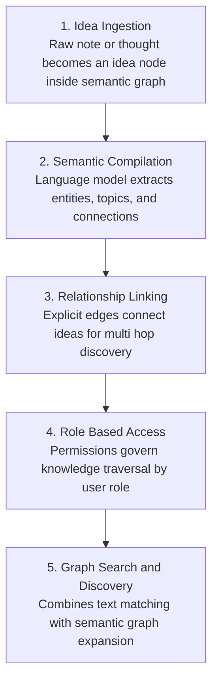
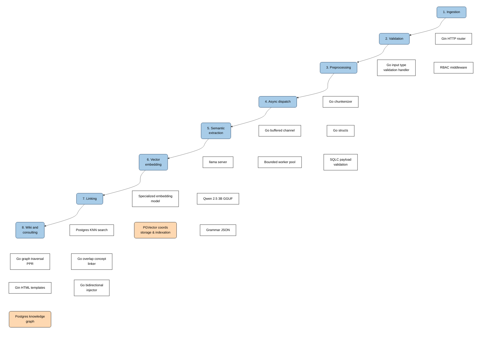

# Thinker

Thinker is an associative knowledge graph and collaborative LLM wiki built for teams that need a shared digital brain. Instead of asking people to manually categorize documents into rigid folders or write bidirectional links by hand, the platform ingests raw notes and thoughts, extracts core concepts with a language model, and compiles them into a living graph structure inspired by the LLM wiki pattern proposed by Andrej Karpathy.

By pairing an interactive neural network graph interface with role based access control, the system lets organizations maintain an autonomous second brain where knowledge compounds naturally as users write.

The codebase provides the core Go web service, dual SQLite and PostgreSQL storage, sqlc generated database access, server rendered HTML templates, asynchronous entity extraction workers, dynamic knowledge graph traversal, and an externalized prompts system.

## Overview

Most note taking platforms rely on folder hierarchies or basic keyword search. When teams scale, these structures quickly break because people organize information differently and maintenance becomes a burden. Standard retrieval augmented generation also falls short over time because it answers questions from scratch by slicing documents into arbitrary chunks without preserving overall context or persistent synthesis.

Thinker treats ideas as an active, compounding artifact:



The present build contains the foundation for user and idea records, authentication, security middleware, named route handling, database access layer, and server rendered template views.

## Stack

#### Backend and language
go 1.26.5
github.com/gin gonic/gin v1.12.0
github.com/gin contrib/multitemplate v1.1.4
github.com/jackc/pgx/v5 v5.11.0
github.com/joho/godotenv v1.5.1
github.com/sashabaranov/go openai v1.43.0
golang.org/x/crypto/argon2

#### Language models and embeddings
Local inference with llama server using Qwen 2.5 3B GGUF
Local embedding inference with llama server using bge small en v1.5
External cloud providers compatible with OpenAI API standard

#### Database and storage
SQLite for local development
PostgreSQL for relational storage and graph relations

#### Frontend
HTML5
CSS with Tailwind 4
JavaScript

## Architecture and data flow


Ingestion
> Gin HTTP router
    Access to a url path via web app.

> RBAC role based access control middleware
    Controls permissions for every idea, keyword, and action according to the user role to enforce enterprise privacy.

Validation
> Go input type validation handler
    Validates that submitted files like pdf, csv, txt, docx match allowed extensions and size limits before processing.

Preprocessing
> Go chunkenizer
    Splits long documents into manageable, coherent text segments so the model can ingest them within context limits.

> Go structs
    Type safe memory structures that hold and transform validated raw data across backend layers.

> SQLC payload validation
    Validates and coerces incoming request parameters into generated database types to reject malformed data before hitting the database.

Async dispatch
> Go buffered channel
Queues validated document tasks in memory so the HTTP handler can respond immediately without blocking the client.

> Bounded worker pool
Limits the number of concurrent background tasks to prevent CPU and memory exhaustion during heavy inference.

Semantic extraction
> llama server or external cloud provider
Inference engine that exposes a lightweight HTTP endpoint compatible with OpenAI API standards.

> Language model concept extraction
Model that reads the text to extract summaries, entities, and conceptual relations using externalized markdown prompts.

>Grammar JSON
Forces the model output into an exact schema to ensure deterministic parsing in Go.

Vector embedding
>Specialized embedding model
Translates extracted concepts and idea texts into dense numerical vectors that capture geometric semantic meaning.

>Vector coordinates storage and indexation
Stores embeddings and accelerates similarity searches through vector indexing.

Linking
>Nearest neighbor vector search
Queries the nearest neighbor vectors in the database to identify candidate ideas with high semantic similarity.

>Go overlap concept linker
Computes intersections between extracted entity tags to reinforce edges that share common named concepts.

>Go bidirectional injector
Creates reciprocal graph edges in the database and inserts bidirectional links into markdown documents.

Wiki and consulting
>Go graph traversal and expansion
Executes graph walks across edges to retrieve deep, multi hop related ideas without flat chunking.

>Gin HTML templates
Renders server side web layouts and interactive graph views directly to the browser.

>Relational knowledge graph
The persistent relational store that preserves all nodes, edges, and permission constraints as a compounding single source of truth.

### Architecture

Thinker is almost entirely built on Go. This decision was taken due to the quickness and native concurrency support provided by the language.

This allows Thinker be structured in different modules comfortably and following SOLID principles with an idiomatic Go approach.

```
└── thinker/
    └── docs/
        └── dev/
        └── user/
    └── internal/
        └── auth/
        └── config/
        └── database/
            └── migrations/
        └── dtos/
        └── handlers/
        └── middleware/
        └── routes/
        └── services/
        └── urls/
    └── models/
    └── prompts/
    └── static/
        └── pages/
            └── landing/
    └── templates/
        └── includes/
        └── layouts/
        └── pages/
            └── auth/
            └── landing/
        └── partials/
            └── ideas/
            └── users/
        └── views/
            └── ideas/
            └── network/
            └── users/
    ├── .env
    ├── .gitignore
    ├── docker-compose.yaml
    ├── go.mod
    ├── go.sum
    ├── main.go
    ├── Makefile
    ├── README.md
    ├── sqlc.yaml
    └── style_schema.md
```

## Current Status

The system currently includes:
1. Gin HTTP setup with graceful initialization and structured routing.
2. Dual database support with SQLite for local development and PostgreSQL with sqlc integration.
3. User authentication with Argon2id password hashing, automatic Bcrypt migration, JWT rotation, and Google OAuth2 integration.
4. Security middleware including IP and account rate limiting, strict CSRF validation, and secure cookie sessions.
5. Asynchronous worker pool for background document processing and semantic analysis.
6. Decoupled AI architecture supporting both local llama server inference and OpenAI API compatible external cloud providers.
7. Externalized prompts architecture in separate markdown documents with dynamic disk loading and embedded fallbacks.
8. Semantic knowledge graph with dynamic text chunking, keyword extraction, and bidirectional similarity linking.
9. Graph traversal engine with multi hop expansion and strict grounding against prompt leakage.
10. Interactive network graph visualization and server rendered HTML templates using Tailwind CSS.
11. Comprehensive unit and integration test suite covering auth, config, middleware, routes, services, and prompts.

## Next Milestones

1. Production deployment setup with native pgvector index optimization.
2. Advanced clustering and topic community detection algorithms across semantic graph nodes.
3. Batch document ingestion supporting automated parsing of PDF, Word, and Markdown files.
4. Export and import tools for knowledge graph backups and interoperability with Obsidian and Logseq.
5. Fine grained role based access control filters applied directly to graph traversal subgraphs.

## References

1. https://gist.github.com/karpathy/442a6bf555914893e9891c11519de94f
