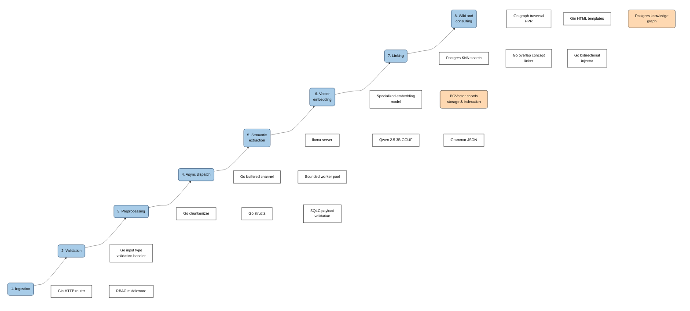
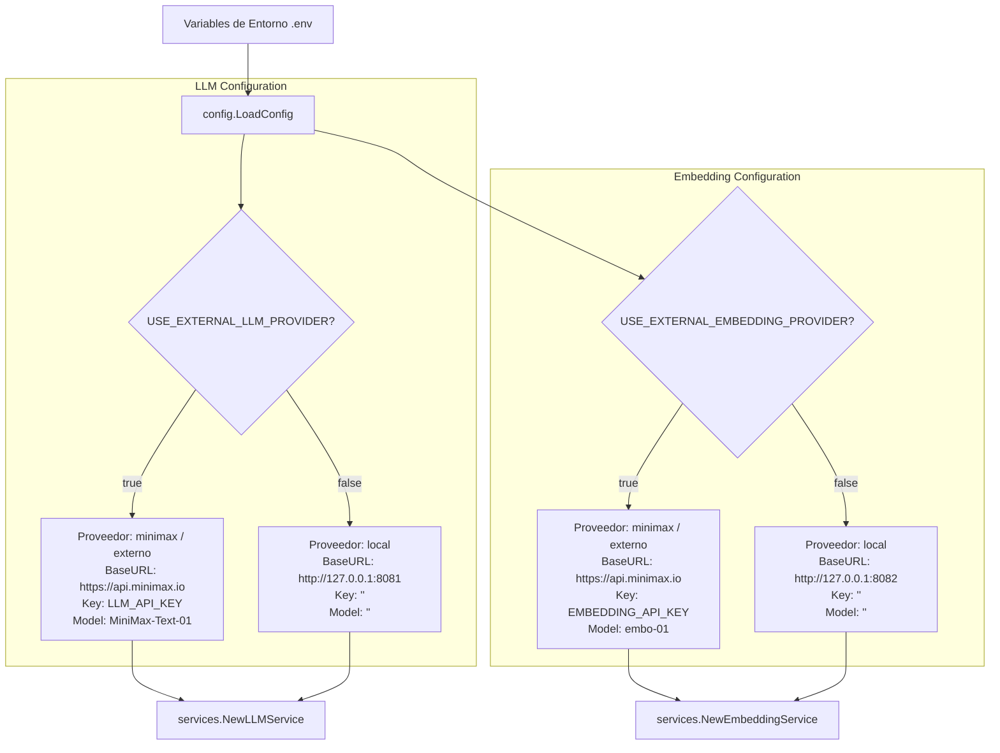

# Thinker

Thinker is an associative knowledge graph and collaborative LLM wiki built for teams that need a shared digital brain. Instead of asking people to manually categorize documents into rigid folders or write bidirectional links by hand, the platform ingests raw notes and thoughts, extracts core concepts with a local language model, and compiles them into a living graph structure inspired by the LLM wiki pattern proposed by Andrej Karpathy.

By pairing a linked interface (graph that looks like a neural network) with role based access control, the system lets organizations maintain an autonomous second brain where knowledge compounds naturally as users write.

The codebase currently provides the core Go web service, PostgreSQL storage, sqlc generated database access, and server rendered HTML templates. The asynchronous entity extraction worker and graph expansion pipeline represent the immediate architectural roadmap.

## Overview

Most note taking platforms rely on folder hierarchies or basic keyword search. When teams scale, these structures quickly break because people organize information differently and maintenance becomes a burden. Standard retrieval augmented generation also falls short over time because it answers questions from scratch by slicing documents into arbitrary chunks without preserving overall context or persistent synthesis.

Thinker treats ideas as an active, compounding artifact:

- Every submitted note or thought becomes an idea node inside a semantic graph.
- A local language model compiles incoming content, extracting entities, identifying topics, and noting connections or contradictions.
- Explicit relationships create edges between ideas, allowing multi hop discovery without relying solely on brittle text matching.
- Role based access control ensures users only discover and traverse knowledge permitted for their organizational role.
- The search experience operates independently of manual tagging by traversing the graph structure and combining text matching with graph expansion.
The present build contains the foundation for user and idea records, named route handling, database access layer, and server rendered template views.

## Stack
- go 1.26.5
> - [github.com/gin-contrib/multitemplate v1.1.4](https://pkg.go.dev/github.com/gin-contrib/multitemplate@v1.1.4)
> - [github.com/gin-gonic/gin v1.12.0](https://pkg.go.dev/github.com/gin-gonic/gin@v1.12.0)
> - [github.com/jackc/pgx/v5 v5.11.0](https://pkg.go.dev/github.com/jackc/pgx/v5@v5.11.0)
> - [github.com/joho/godotenv v1.5.1](https://pkg.go.dev/github.com/joho/godotenv@v1.5.1)

- LLM
> - [Qwen2.5-3B-Instruct-GGUF](https://huggingface.co/Qwen/Qwen2.5-3B-Instruct-GGUF)
> - [MiniMax M3.1 Flash](https://www.minimax.io/blog/minimax-m31f)

- HTML5
- CSS
> - [Tailwind 4](https://tailwindcss.com/docs/installation/using-vite)
- JavaScript

## Architecture and data flow



1. Ingestion
- Gin HTTP router
    > Access to a url path via web app.
- RBAC (Role-based access control) middleware
    > Controls permissions for every idea, keyword, and action according to the user role to enforce enterprise privacy.

2. Validation
- Go input type validation handler
    > Validates that submitted files (.pdf, .csv, .txt, .docx) match allowed extensions and size limits before processing.

3. Preprocessing
- Go chunkenizer
    > Splits long documents into manageable, coherent text segments so the local model can ingest them within its context limits.
- Go structs
    > Type-safe memory structures that hold and transform validated raw data across backend layers.
- SQLC payload validation
    > Validates and coerces incoming request parameters into generated database types to reject malformed data before hitting the database.

4. Async dispatch
- Go buffered channel
    > Queues validated document tasks in memory so the HTTP handler can respond immediately without blocking the client.
- Bounded worker pool
    > Limits the number of concurrent background tasks to prevent local CPU and memory exhaustion during heavy inference.

5. Semantic extraction
- llama server
    > High-performance C++ inference engine that exposes a lightweight local HTTP endpoint for the model without Python overhead.
- Qwen 2.5 3B GGUF
    > Fast, low-footprint local language model that reads the text to extract summaries, entities, and conceptual relations.
- Grammar JSON
    > Forces the model output into an exact schema via GBNF grammars to ensure deterministic parsing in Go.

6. Vector embedding
- specialized embedding model
    > Translates extracted concepts and idea texts into dense numerical vectors that capture geometric semantic meaning.
- PGVector vector cords storage and indexation
    > Stores embeddings in PostgreSQL and accelerates similarity searches through HNSW indexing.

7. Linking
- Postgres knn search
    > Queries the nearest neighbor vectors in the database to identify candidate ideas with high semantic similarity.
- Go overlap concept linker
    > Computes intersections between extracted entity tags to reinforce edges that share common named concepts.
- Go bidirectional injector
    > Creates reciprocal graph edges in the database and inserts bidirectional links into markdown documents.

8. Wiki and consulting
- Go graph traversal PPR
    > Executes Personalized PageRank walks across graph edges to retrieve deep, multi-hop related ideas without flat chunking.
- Gin HTML templates
    > Renders server-side web layouts and interactive graph views directly to the browser.
- Postgres knowledge graph
    > The persistent relational store that preserves all nodes, edges, and permission constraints as a compounding single source of truth.

### Architecture

Thinker is almost enteraly built on Go. This decision was taken due to the quickness and native concurrency support provided by the language.

This allows Thinker be structured in different modules confortably and following SOLID principles with an idiomatic Go approach.

```
└── thinker/
    └── docs/
    └── internal/
        └── config/
        └── database/
        └── dtos/
        └── handlers/
        └── routes/
        └── urls/
    └── models/
    └── static/
    └── templates/
        └── includes/
        └── layouts/
        └── pages/
        └── views/
    ├── .env
    ├── .gitignore
    ├── docker-compose.yaml
    ├── go.mod
    ├── go.sum
    ├── main.go
    ├── README.md
    ├── README.pdf
    ├── sqlc.yaml
    └── style_schema.md
```

## Current Status

The system currently includes:
- Gin HTTP setup and graceful initialization.
- Single pool PostgreSQL connector with sqlc integration.
- User listing through both JSON APIs and HTML pages.
- Basic idea listing views.
- Centralized route directory with reverse template resolution.
- Base layout composition using Tailwind CSS.
- Targeted routing and rendering unit tests.

## Next Milestones

- Implement authentication, session handling, and role based access control on notes and graph queries.
- Upgrade the PostgreSQL container setup to support pgvector natively.
- Set up a bounded Go worker pool for asynchronous note ingestion and relationship building.
- Connect the worker pool to a local Qwen 2.5 3B instance for concept extraction and summary generation.
- Create graph edge tables to store typed links and mutual relevance scores.
- Implement graph traversal queries with role aware filters using recursive SQL queries.
- Build an interactive visual graph explorer view in the web interface.

## References
1. https://gist.github.com/karpathy/442a6bf555914893e9891c11519de94f


# Plan de Implementación: Soporte para MiniMax y Proveedores Externos vs Locales

Este plan define la arquitectura y los pasos para desacoplar y configurar de forma independiente los proveedores de **Generación (LLM)** y **Embeddings**, permitiendo alternar entre modelos locales (`llama-server`) y proveedores externos en la nube (**MiniMax** u otros compatibles con la API de OpenAI) a través de banderas de entorno explícitas.

---

## Descripción del Objetivo

El sistema actual fue concebido para interactuar con `llama-server` local en los puertos `8081` y `8082`. Sin embargo, las máquinas locales con restricciones de RAM o GPU no siempre pueden alojar modelos pesados en local.

MiniMax ofrece endpoints compatibles con el estándar de OpenAI tanto para chat (`MiniMax-Text-01` o `abab6.5s-chat`) como para embeddings (`embo-01`). Para operar con ellos de forma limpia y extensible, necesitamos:
1. Reconocer las banderas `USE_EXTERNAL_LLM_PROVIDER` y `USE_EXTERNAL_EMBEDDING_PROVIDER` de forma independiente.
2. Separar completamente las configuraciones de autenticación y endpoints (`LLM_API_KEY` vs `EMBEDDING_API_KEY`, `LLM_BASE_URL` vs `EMBEDDING_BASE_URL`, `LLM_MODEL` vs `EMBEDDING_MODEL`).
3. Enviar el campo obligatorio `"model"` en el cuerpo JSON de las solicitudes HTTP tanto en `chat/completions` como en `embeddings`.
4. Normalizar URLs para tolerar tanto sufijos `/v1` como rutas base limpias.
5. Mantener compatibilidad absoluta con todos los tests unitarios existentes.

---

## User Review Required

> [!IMPORTANT]
> **Autonomía de credenciales:**
> Aunque en tu archivo `.env` ambas claves apunten al mismo valor (`LLM_API_KEY` y `EMBEDDING_API_KEY`), el cargador de configuración tratará cada servicio como una entidad totalmente independiente. No habrá acoplamiento cruzado.

> [!NOTE]
> **Compatibilidad de Embeddings:**
> Como acordamos, no se requiere migración de los embeddings existentes en este paso. Al activar MiniMax (`embo-01`), las nuevas notas y búsquedas generarán vectores de 1536 dimensiones.

---

## Open Questions

1. **URL base por defecto de MiniMax:**
   MiniMax dispone de dos dominios principales según la cuenta: `https://api.minimax.io` (internacional/global) y `https://api.minimax.chat` (portal alternativo). Estableceremos por defecto `https://api.minimax.io` con posibilidad de sobreescribirlo libremente en `LLM_BASE_URL` / `EMBEDDING_BASE_URL`. ¿Tu cuenta de MiniMax usa el portal internacional (`api.minimax.io`)?
2. **Modelo de texto preferido:**
   ¿Prefieres `MiniMax-Text-01` o `abab6.5s-chat` como modelo por defecto para generación de texto? (Ambos son configurables vía `LLM_MODEL`).

---

## Arquitectura de Configuración



---

## Proposed Changes

### 1. Capa de Configuración (`internal/config`)

#### [MODIFY] [internal/config/config.go](file:///c:/Users/Analista-GDL/iCloudDrive/Developer_shared/thinker1/thinker/internal/config/config.go)
- Extender la estructura `BaseConfig` con:
  ```go
  UseExternalLLM       bool
  LLMProvider          string
  LLMApiKey            string
  LLMBaseURL           string
  LLMModel             string

  UseExternalEmbedding bool
  EmbeddingProvider    string
  EmbeddingApiKey      string
  EmbeddingBaseURL     string
  EmbeddingModel       string
  ```
- Implementar la función auxiliar `normalizeBaseURL(url string) string` que elimina `/` al final y remueve `/v1` si fue provisto para prevenir concatenaciones erróneas (`/v1/v1/chat/completions`).
- Implementar la lógica condicional en `LoadConfig()`:
  - Leer booleanos para `USE_EXTERNAL_LLM_PROVIDER` y `USE_EXTERNAL_EMBEDDING_PROVIDER`.
  - Si es externo, aplicar valores por defecto de MiniMax (`https://api.minimax.io`, `MiniMax-Text-01`, `embo-01`) salvo que el `.env` especifique otros valores.
  - Si es local, aplicar valores por defecto de `llama-server` (`http://127.0.0.1:8081` y `8082`, modelos vacíos).
  - Leer de forma aislada `LLM_API_KEY` y `EMBEDDING_API_KEY`.

---

### 2. Capa de Servicios (`internal/services`)

#### [MODIFY] [internal/services/llm_service.go](file:///c:/Users/Analista-GDL/iCloudDrive/Developer_shared/thinker1/thinker/internal/services/llm_service.go)
- Agregar campos a `LLMService`:
  ```go
  type LLMService struct {
      baseURL    string
      apiKey     string
      model      string
      provider   string
      httpClient *http.Client
  }
  ```
- Permitir firma variádica en `NewLLMService`:
  ```go
  func NewLLMService(baseURL, apiKey string, model ...string) *LLMService
  ```
  *(Esto garantiza que los tests unitarios existentes que llaman a `NewLLMService(url, key)` sigan compilando sin romperse).*
- Agregar métodos `SetModel(m string)` y `Model() string`.
- Modificar `chatCompletionRequest` para incluir `"model"` opcional/condicional:
  ```go
  type chatCompletionRequest struct {
      Model       string        `json:"model,omitempty"`
      Messages    []chatMessage `json:"messages"`
      Temperature float64       `json:"temperature"`
      MaxTokens   int           `json:"max_tokens"`
  }
  ```
- En `AnalyzeIdea`, `ExpandQuery` y `AskKnowledgeGraph`, asignar `Model: s.model`.

#### [MODIFY] [internal/services/embedding_service.go](file:///c:/Users/Analista-GDL/iCloudDrive/Developer_shared/thinker1/thinker/internal/services/embedding_service.go)
- Agregar campos a `EmbeddingService`:
  ```go
  type EmbeddingService struct {
      baseURL    string
      apiKey     string
      model      string
      provider   string
      httpClient *http.Client
  }
  ```
- Permitir firma variádica en `NewEmbeddingService`:
  ```go
  func NewEmbeddingService(baseURL, apiKey string, model ...string) *EmbeddingService
  ```
- Modificar `embeddingRequest` para incluir `"model"`:
  ```go
  type embeddingRequest struct {
      Model string `json:"model,omitempty"`
      Input string `json:"input"`
  }
  ```
- En `GenerateEmbedding`, asignar `Model: s.model`.

---

### 3. Punto de Entrada (`main.go`)

#### [MODIFY] [main.go](file:///c:/Users/Analista-GDL/iCloudDrive/Developer_shared/thinker1/thinker/main.go)
- Actualizar la inicialización de los servicios:
  ```go
  llmService := services.NewLLMService(baseConfig.LLMBaseURL, baseConfig.LLMApiKey, baseConfig.LLMModel)
  embeddingService := services.NewEmbeddingService(baseConfig.EmbeddingBaseURL, baseConfig.EmbeddingApiKey, baseConfig.EmbeddingModel)
  ```
- Agregar logs informativos al arranque que evidencien el modo activo:
  ```go
  log.Printf("[llm] Proveedor: %s (Externo: %v) | URL: %s | Modelo: %s", baseConfig.LLMProvider, baseConfig.UseExternalLLM, baseConfig.LLMBaseURL, baseConfig.LLMModel)
  log.Printf("[embedding] Proveedor: %s (Externo: %v) | URL: %s | Modelo: %s", baseConfig.EmbeddingProvider, baseConfig.UseExternalEmbedding, baseConfig.EmbeddingBaseURL, baseConfig.EmbeddingModel)
  ```

---

### 4. Entorno de Configuración (`.env`)

#### [MODIFY] [.env](file:///c:/Users/Analista-GDL/iCloudDrive/Developer_shared/thinker1/thinker/.env)
- Agregar las variables de control y defaults documentados:
  ```dotenv
  # --- AI Providers Configuration ---
  USE_EXTERNAL_LLM_PROVIDER=true
  LLM_PROVIDER=minimax
  LLM_API_KEY=tu_api_key_aqui
  LLM_BASE_URL=https://api.minimax.io
  LLM_MODEL=MiniMax-Text-01

  USE_EXTERNAL_EMBEDDING_PROVIDER=true
  EMBEDDING_PROVIDER=minimax
  EMBEDDING_API_KEY=tu_api_key_aqui
  EMBEDDING_BASE_URL=https://api.minimax.io
  EMBEDDING_MODEL=embo-01
  ```

---

### 5. Pruebas Unitarias (`internal/config` & `internal/services`)

#### [NEW] [internal/config/config_provider_test.go](file:///c:/Users/Analista-GDL/iCloudDrive/Developer_shared/thinker1/thinker/internal/config/config_provider_test.go)
- Validar que con `USE_EXTERNAL_LLM_PROVIDER=true` se resuelvan correctamente las credenciales y URLs de MiniMax.
- Validar que con `USE_EXTERNAL_LLM_PROVIDER=false` se resuelvan los defaults locales de `127.0.0.1:8081`.
- Validar normalización de URLs (con y sin `/v1`, trailing slashes).
- Validar que `LLM_API_KEY` y `EMBEDDING_API_KEY` se carguen de manera independiente sin mezclarse.

#### [NEW] [internal/services/provider_payload_test.go](file:///c:/Users/Analista-GDL/iCloudDrive/Developer_shared/thinker1/thinker/internal/services/provider_payload_test.go)
- Validar mediante un HTTP mock client que cuando `model` está configurado (`embo-01` o `MiniMax-Text-01`), el payload JSON enviado al servidor contenga el campo `"model"` respectivo.
- Validar que cuando `model` está vacío (modo local), el payload no rompa y mantenga compatibilidad.

---

## Verification Plan

### Automated Tests
1. Ejecutar las nuevas pruebas de configuración y serialización:
   ```powershell
   go test -v ./internal/config/...
   go test -v ./internal/services/... -run "TestProviderPayload"
   ```
2. Ejecutar la suite completa para asegurar regresión cero:
   ```powershell
   go test ./...
   ```

### Manual Verification
1. Configurar en `.env` las variables con `USE_EXTERNAL_LLM_PROVIDER=true` y `USE_EXTERNAL_EMBEDDING_PROVIDER=true` con tu API key de MiniMax.
2. Ejecutar `go run main.go` y verificar que los logs muestren claramente:
   - Proveedor de LLM MiniMax y URL `https://api.minimax.io`.
   - Proveedor de Embedding MiniMax y modelo `embo-01`.
3. Crear o reanalizar una idea desde la interfaz web o enviar una consulta para verificar la respuesta del API en vivo.
