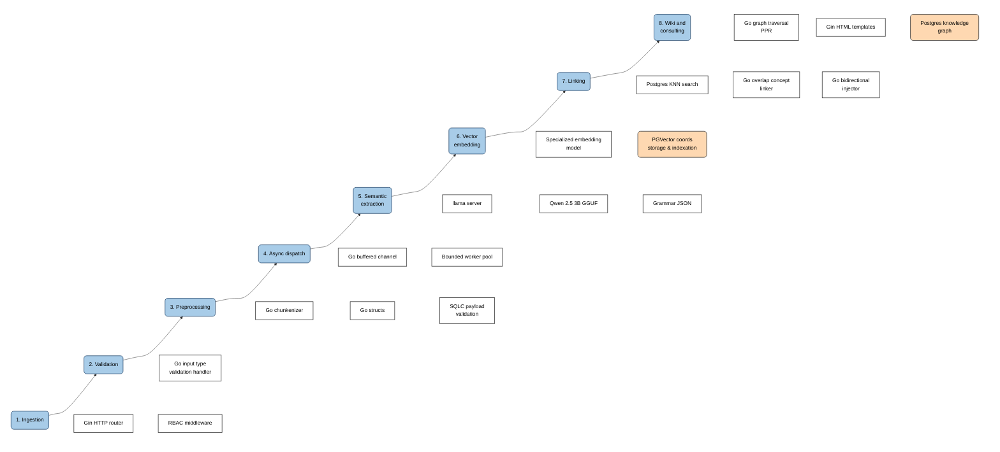

# Architecture

## Data flow

1. Ingestion
- Gin HTTP router
    > Access to a url path via web app.

- RBAC (Control de accesos basado en roles) middleware
    > Controls permissions for every idea, keyword, and action according to the user role to enforce enterprise privacy.

2. Validation
- Go input type validation handler
    > Validates that submitted files (.pdf, .csv, .txt, .docx) match allowed extensions and size limits before processing.

3. Preprocessing
- Go chunkenizer
    > Splits long documents into manageable, coherent text segments so the local model can ingest them within its context limits.

- Go structs
    > Type-safe memory structures that hold and transform validated raw data across backend layers.

- SQLC payload validation
    > Validates and coerces incoming request parameters into generated database types to reject malformed data before hitting the database.

4. Async dispatch
- Go buffered channel
    > Queues validated document tasks in memory so the HTTP handler can respond immediately without blocking the client.

- Bounded worker pool
    > Limits the number of concurrent background tasks to prevent local CPU and memory exhaustion during heavy inference.

5. Semantic extraction
- llama server
    > High-performance C++ inference engine that exposes a lightweight local HTTP endpoint for the model without Python overhead.

- Qwen 2.5 3B GGUF
    > Fast, low-footprint local language model that reads the text to extract summaries, entities, and conceptual relations.

- Grammar JSON
    > Forces the model output into an exact schema via GBNF grammars to ensure deterministic parsing in Go.

6. Vector embedding
- specialized embedding model
    > Translates extracted concepts and idea texts into dense numerical vectors that capture geometric semantic meaning.

- PGVector vector cords storage and indexation
    > Stores embeddings in PostgreSQL and accelerates similarity searches through HNSW indexing.

7. Linking
- Postgres knn search
    > Queries the nearest neighbor vectors in the database to identify candidate ideas with high semantic similarity.

- Go overlap concept linker
    > Computes intersections between extracted entity tags to reinforce edges that share common named concepts.

- Go bidirectional injector
    > Creates reciprocal graph edges in the database and inserts bidirectional links into markdown documents.

8. Wiki and consulting
- Go graph traversal PPR
    > Executes Personalized PageRank walks across graph edges to retrieve deep, multi-hop related ideas without flat chunking.

- Gin HTML templates
    > Renders server-side web layouts and interactive graph views directly to the browser.

- Postgres knowledge graph
    > The persistent relational store that preserves all nodes, edges, and permission constraints as a compounding single source of truth.